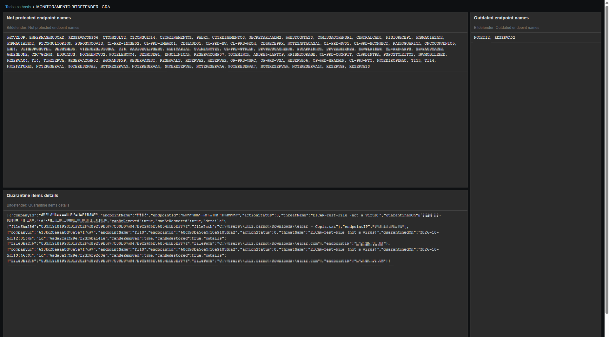

## Project Repository

Source code, documentation, bug reports, and feature requests are available on GitHub:

[Bitdefender GravityZone Zabbix Template](https://github.com/luizcarmo1/bitdefender-gravityzone-zabbix-template)

**Template file:** [template_bitdefender_gravityzone.yaml](https://github.com/luizcarmo1/bitdefender-gravityzone-zabbix-template/blob/main/Applications/Anti-Virus/Bitdefender/template_bitdefender_gravityzone/7.0/template_bitdefender_gravityzone.yaml)

Zabbix 7.0 LTS template for monitoring **Bitdefender GravityZone Cloud** through the GravityZone Public API.

The template collects endpoint inventory and quarantine information, calculates protection metrics, and generates alerts for security conditions that require attention.

## Requirements

- Zabbix server 7.0 LTS.
- A Bitdefender GravityZone Cloud account.
- A GravityZone API key with the required permissions for Network and Quarantine API services.
- HTTPS connectivity from the Zabbix server or proxy to the GravityZone API.

## Installation

1. Download `template_bitdefender_gravityzone.yaml`.
2. In the Zabbix frontend, navigate to **Data collection → Templates**.
3. Click **Import** and select the YAML file.
4. Review the import options and complete the import.
5. Create or select a host representing your GravityZone environment.
6. Link the **BitDefender Gravityzone by HTTP** template to the host.
7. Configure the required macros described below.
8. Check **Monitoring → Latest data** and verify that the master items are collecting data successfully.

Menu labels may vary slightly between Zabbix releases.

## Dashboard

The template includes a Zabbix dashboard for monitoring Bitdefender GravityZone endpoint protection and quarantine activity.

### Overview

### Quarantine Monitoring

## Configuration

### Required macros

Configure these macros at the template or host level.

| Macro | Description | Example |
|---|---|---|
| `{$BITDEFENDER.API.URL}` | Base URL of the GravityZone API | `https://cloud.gravityzone.bitdefender.com/api` |
| `{$BITDEFENDER.API.KEY}` | GravityZone API key | Your API key |
| `{$BITDEFENDER.API.VERSION}` | Version used by the Network API endpoint | `v1.1` |

Store `{$BITDEFENDER.API.KEY}` as **Secret text**. Replace example values with the appropriate values for your environment.

The Network API URL is constructed using the base URL, API version, and endpoint path. The Quarantine API uses its configured endpoint path and version.

### API permissions

Enable the API services required by the template when creating or configuring the GravityZone API key.

- **Network:** Required for endpoint inventory and protection metrics.
- **Quarantine:** Required for quarantine statistics and item details.

API permissions and available methods depend on your GravityZone subscription and configuration.

## Collected metrics

### Endpoint monitoring

| Item | Description |
|---|---|
| `Bitdefender: Get endpoints data` | Retrieves endpoint inventory from the Network API. |
| `Bitdefender: Total endpoints` | Total endpoints returned by the inventory. |
| `Bitdefender: Endpoints protected` | Number of endpoints managed with Bitdefender BEST. |
| `Bitdefender: Endpoints not protected` | Number of endpoints that do not meet the template's protection criteria. |
| `Bitdefender: Not protected endpoint names` | Names of endpoints that do not meet the protection criteria. |
| `Bitdefender: Outdated endpoints` | Number of managed endpoints with outdated products. |
| `Bitdefender: Outdated endpoint names` | Names of managed endpoints with outdated products. |
| `Bitdefender: Up-to-date endpoints` | Number of managed endpoints whose products are up to date. |

### Quarantine monitoring

| Item | Description |
|---|---|
| `Bitdefender: Get quarantine data` | Retrieves quarantine records from the Quarantine API. |
| `Bitdefender: Total items in quarantine` | Total number of items in quarantine. |
| `Bitdefender: New quarantine items (10m)` | Number of items quarantined within the last 10 minutes. |
| `Bitdefender: Unique affected endpoints` | Number of distinct endpoints represented in quarantine records. |
| `Bitdefender: Unique detected threats` | Number of distinct threat names in quarantine records. |
| `Bitdefender: Restorable items` | Number of items marked as restorable by the API. |
| `Bitdefender: Removable items` | Number of items marked as removable by the API. |
| `Bitdefender: Latest quarantine item details` | Text summary of the most recent quarantine item. |

Some dependent items may be included in the YAML export in addition to the items listed above.

## Triggers

| Trigger | Condition |
|---|---|
| `Bitdefender: Endpoints not protected detected` | Activates when the number of unprotected endpoints is greater than zero. Recovers when the count reaches zero. |
| `Bitdefender: Outdated agents detected` | Activates when the number of outdated endpoints is greater than zero. Recovers when the count reaches zero. |
| `Bitdefender: Quarantine items detected` | Activates when the quarantine count is greater than one. Recovers when the count reaches zero. |

The quarantine trigger intentionally does not activate when exactly one item is present. If a problem is already active and the count decreases to one, the problem remains active until the count reaches zero.

## Dashboard

The template can be used with a Zabbix dashboard to display:

- Total, protected, unprotected, outdated, and up-to-date endpoints.
- Quarantine statistics, including restorable and removable items.
- Quarantine activity over time.
- Outdated and unprotected endpoint counts over time.
- Active security problems generated by the template's triggers.

Dashboard widgets may need to be configured separately, depending on your environment and preferences.

## Troubleshooting

### Master items are failing

- Verify the API URL and API key.
- Check that the API key has the required Network or Quarantine permissions.
- Review the item's error message in **Monitoring → Latest data**.
- Check network connectivity and HTTPS access to the GravityZone API.
- Review the Zabbix server or proxy logs for script execution timeouts or API errors.

### Endpoint counts do not match expectations

The unprotected count includes endpoints that are not managed or do not have Bitdefender BEST properly managed, according to the fields returned by the Network API. It should not be interpreted as a count of endpoints without any antivirus software.

### Quarantine metrics are empty

Verify that the Quarantine API service is enabled for the API key and that the API returns quarantine data for your GravityZone environment.

## Security

- Store API keys in Secret text macros.
- Do not commit credentials, internal endpoint names, or production data.
- Restrict API permissions to the services required for monitoring.

## References

- [Bitdefender GravityZone](https://www.bitdefender.com/business/)
- [Bitdefender Get Quarantine Items List API](https://www.bitdefender.com/business/support/en/77211-140256-getquarantineitemslist.html)
- [Zabbix Community Template Guidelines](https://www.zabbix.com/documentation/guidelines/en/thosts/community_templates)

## Author

[Luiz Carmo](https://github.com/luizcarmo1)

## Disclaimer

This community template is not an official Bitdefender or Zabbix product. Bitdefender and GravityZone are trademarks of their respective owners.