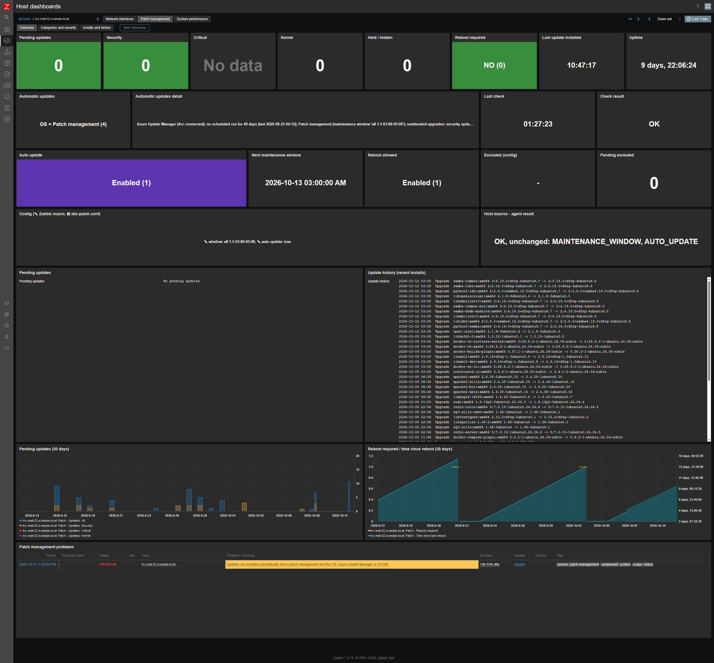
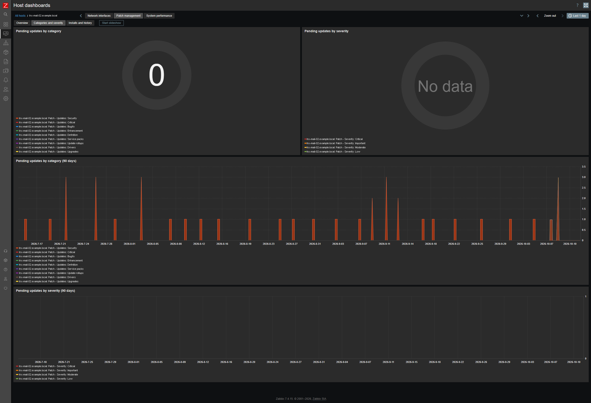
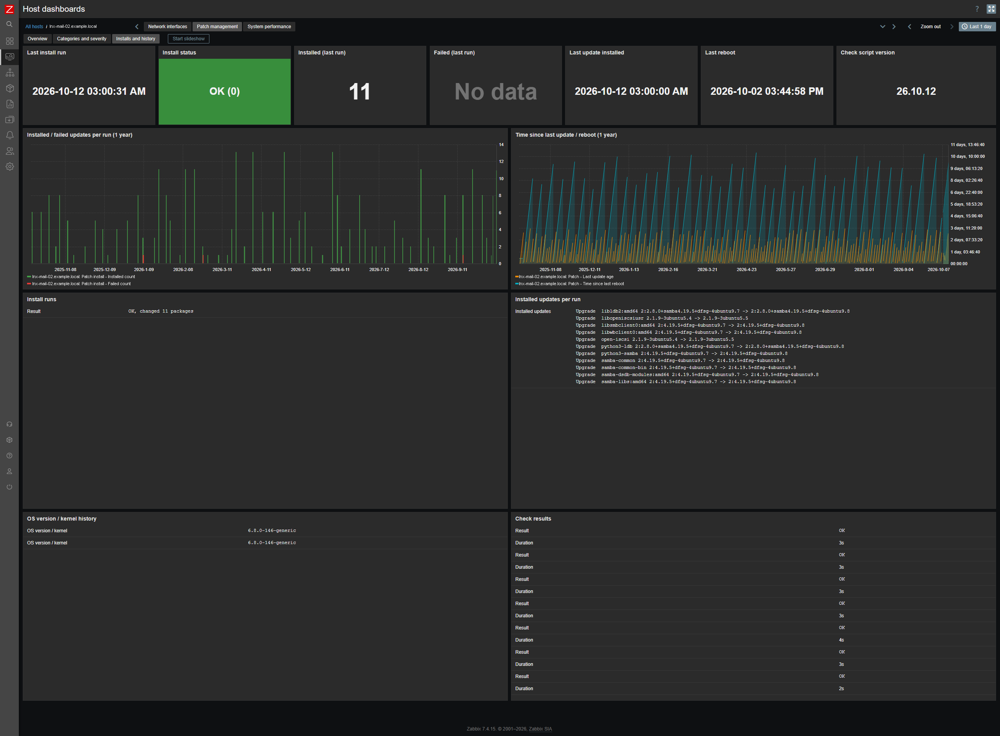
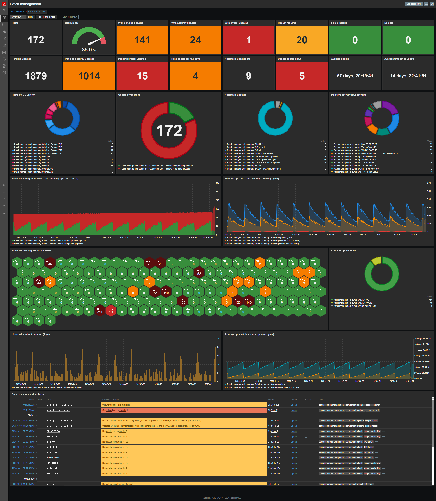
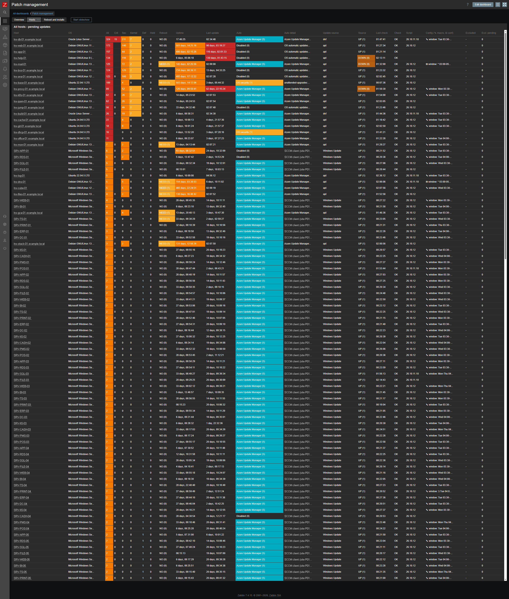
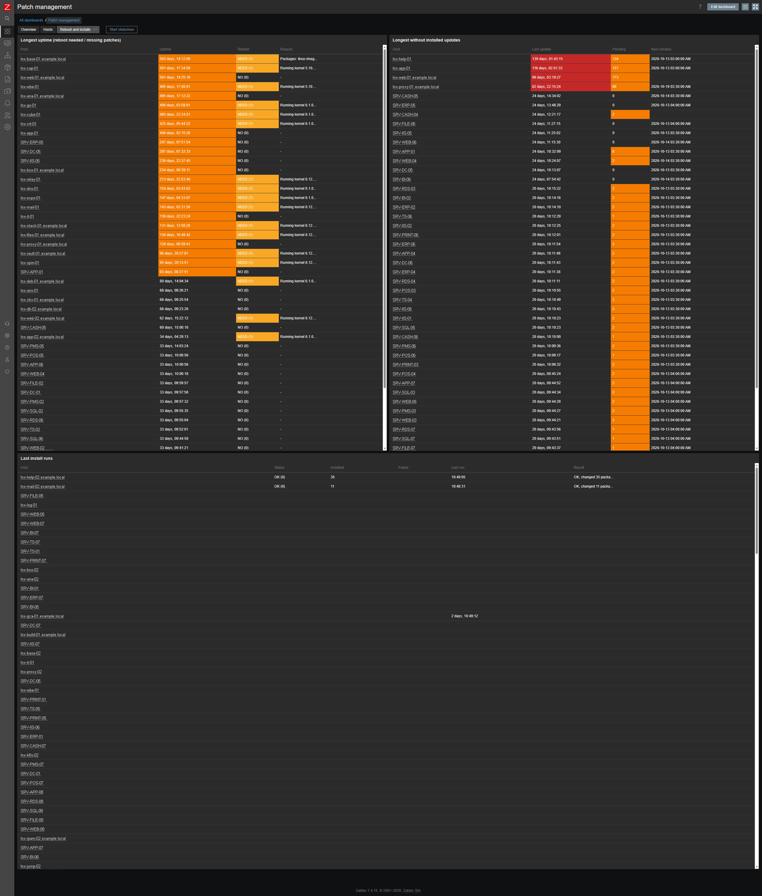

# PatchBix – Zabbix patch management for Windows and Linux

**PatchBix** is **Zabbix patch management**: the update status and the updates of Windows and Linux servers, monitored and managed from Zabbix.

One Zabbix template to see the **update status of all your Windows and Linux servers in one place**, with the **same keys on every OS**: how many updates are pending (security, critical, by severity, kernel, …), which ones, what was installed recently, whether a reboot is needed, when the host was last patched and with what result.

> **Update management fully controlled from Zabbix – no extra ports, no extra agent.**
> Everything goes over the existing **Zabbix agent communication** (active checks and zabbix_sender to the Zabbix server / proxy, port 10051). There is no inbound port to open on the hosts and no other management server or agent to install.
> From Zabbix you **see** the update status of every host and **manage** the updates with host macros: the **maintenance window and the update types**, **automatic updates on / off** and **reboot allowed** – per host, per template or globally.



*Host dashboard **PatchBix - Patch management**, included in the template (sample data). More screenshots are in [Dashboards](#dashboards).*

## 🆕 Newer version on my GitHub

**The newest version of PatchBix is on my GitHub:** https://github.com/DuprTECH/PatchBix-Zabbix-Patch-Management-Windows-Linux

- 🆕 **Template for Zabbix 8.0** (only on my GitHub) and the newest template for Zabbix 7.4
- 🚫 **Excluded updates** – updates and packages that are never installed, per host or from a Zabbix host macro
- 🚨 **Forced update for a critical vulnerability** – update just the affected packages right away from Zabbix, also outside the maintenance window and also when they are excluded, with the reboot right away or in the next maintenance window
- 🤖 **Ansible playbooks**, more scripts and the **full documentation** of all items, triggers and options

## ✨ Highlights

- 🎛️ **Fully managed from Zabbix**: maintenance window and update types, automatic updates on / off and reboot – set as host macros, applied by the agent on the host within ~5 minutes.
- 🪟🐧 **One template for Windows and Linux**: Windows Update, apt (Debian, Ubuntu), dnf / yum (RHEL, Rocky, Alma, Oracle, Fedora). The same keys (`patch.*`), so dashboards, triggers and reports work the same for every OS.
- 📋 **Pending updates** by category and **severity**, plus the **list of pending updates** and the **update history**
- 🔁 **Reboot required and why**, last reboot time, uptime, last update installed, result of the last install run
- 🤖 **Optional automatic updates**: set a maintenance window with update types (for example critical and security updates every night) and turn on the automatic updates – the check script installs them itself in the window, reboots when allowed and reports the result. The default is **check only**.
- 📊 **Host dashboard** included in the template
- 🚨 **Triggers**: critical / security updates pending, reboot pending too long, update source unavailable, check failed, install run failed, invalid maintenance window, **no data from a host**
- 🧙 **One-file setup wizard** for Windows and Linux – no Ansible, no internet access needed on the host

## Contents

| File | Description |
|------|-------------|
| `template_patch_management.yaml` | Zabbix **7.4** export with the template `PatchBix - Patch management all OS` (items, triggers, host dashboard) |
| `files/scripts/patchbix-setup-windows.ps1` | Setup wizard for a Windows host (check script embedded) |
| `files/scripts/patchbix-setup-linux.sh` | Setup wizard for a Linux host (check script embedded) |
| `files/images/` | Dashboard screenshots |

**Ansible playbooks, more scripts and the newest versions** are on my GitHub: https://github.com/DuprTECH/PatchBix-Zabbix-Patch-Management-Windows-Linux – there you also find the **full documentation of all items, triggers and options**.

## Dashboards

> 🕵️ The screenshots show **sample data** (anonymized host names).

### Host dashboard – part of the template ✅

The **host dashboard is included in the template** and is imported with it (*Monitoring → Hosts → Dashboards → PatchBix - Patch management*), with the same widgets on Windows and Linux.

| Overview | Categories and severity | Installs and history |
|:---:|:---:|:---:|
| [](files/images/host_dashboard_1.png) | [](files/images/host_dashboard_2.png) | [](files/images/host_dashboard_3.png) |

### Global dashboard – on request 📨

The **global dashboard of all hosts is not part of the template** (Zabbix can't export a global dashboard together with a template). **Write to me and I'll send it to you**, or help you fit it to your environment: 📧 [info@duprtech.sk](mailto:info@duprtech.sk)

| Overview | All hosts | Reboot and installs |
|:---:|:---:|:---:|
| [](files/images/global_dashboard_1.png) | [](files/images/global_dashboard_2.png) | [](files/images/global_dashboard_3.png) |

## Requirements

- Zabbix server / proxy **7.4** or newer, reachable from the hosts on port **10051** (zabbix_sender)
- **Windows**: Zabbix agent 2 (includes `zabbix_sender.exe`), Windows PowerShell 5.1
- **Linux**: `zabbix_sender` (package `zabbix-sender`, the wizard installs it when the Zabbix repository is configured), bash
- The **host name in Zabbix** must match the `Hostname` in the agent config (or the computer name / `uname -n` when the config has no `Hostname`).

## Installation

### 1. Zabbix

1. Import `template_patch_management.yaml` (*Data collection → Templates → Import*).
2. Link `PatchBix - Patch management all OS` to your Windows and Linux hosts.

### 2. Hosts – setup wizard

The wizards do everything on one host. The check script is **embedded** in them, so they need no internet access – copy the file to the host, or paste it into a root shell / PowerShell as administrator. A menu asks what to do:

| Choice | What it does |
|--------|--------------|
| **1 monitor** (default) | installs the check script, schedules the check every 12 h and after a reboot, schedules the automatic update, writes `patchbix.conf`, installs the `UserParameter` for the settings from Zabbix and runs the check right away |
| **2 check** | runs the check now and shows the patch settings |
| **3 update** | installs the updates now – only in the maintenance window, reboots when needed and allowed, result to Zabbix |
| **4 force** | like 3, also outside the maintenance window |

Running it again **updates an installed host** and keeps its settings.

**Windows** (PowerShell as administrator):
```powershell
powershell.exe -NoProfile -ExecutionPolicy Bypass -File patchbix-setup-windows.ps1
```

**Linux** (as root):
```bash
sudo bash patchbix-setup-linux.sh
sudo INTERVAL_HOURS=4 bash patchbix-setup-linux.sh     # check every 4 hours
```

By default the hosts **only report** – nothing is installed until you set a maintenance window and turn on the automatic updates.

**Upgrade from the older version of this template** (`APP Patch management all OS`, scripts `zbx-patch-*`): import the new template over the old one (same UUID – it is renamed, the links and the history stay) and run the wizard on the hosts. It moves the old settings to the PatchBix names and removes the old scripts and schedules.

## Settings from Zabbix (host macros)

| Macro | Values |
|-------|--------|
| `{$PATCH.CONF.AUTO_UPDATE}` | `true` / `false` – automatic updates in the maintenance window |
| `{$PATCH.CONF.WINDOW}` | `all Wed 03:00-05:00`, `crit+sec 1-7 02:00-03:00, all Sat 03:00-06:00`; `all` = all update types, `1-7` = every day, `none` = no window |
| `{$PATCH.CONF.REBOOT}` | `true` / `false` – reboot after updates when needed |

> ⚠️ **No `*` in the macros** – the Zabbix agent refuses the whole item. Use `all` and `1-7` instead.

Excluded updates and the forced update for a critical vulnerability are described in the [newer version on my GitHub](#-newer-version-on-my-github).

The same settings can be set on the host in `patchbix.conf` (Linux `/etc/zabbix/patchbix.conf`, Windows next to the agent config); a host macro wins.

**Other macros**: `{$PATCH.NODATA}` (`2d`), `{$PATCH.REBOOT.MAXAGE}` (`7d`), `{$PATCH.LASTUPDATE.MAXAGE}` (`30d`), `{$PATCH.CHECK.CMD}`.

## Notes

- **Test on a few hosts first**, especially on your distributions and Windows versions.
- **Allowed hosts of the trapper items**: the template sets them to `0.0.0.0/0,::/0` (any host). Restrict them to your networks if you want.
- Don't put the PatchBix maintenance windows into a Zabbix maintenance with *No data collection* – the install results would be dropped.

## Support, deployment & custom work

🤝 **I provide support for this solution, including a complete deployment** in your environment: template and dashboards, check scripts on the hosts, Ansible patching with reporting, and the global dashboard of all hosts. Custom extensions (approval workflows, staged rollouts, reporting, WSUS / SCCM / Intune / AWX integration) on request: 📧 [info@duprtech.sk](mailto:info@duprtech.sk)

## More scripts, playbooks and frequent updates

This folder holds a snapshot of the template and the setup wizards. **Ansible playbooks, more scripts, the full documentation and frequent updates are on my GitHub:**

👉 **Repository:** https://github.com/DuprTECH/PatchBix-Zabbix-Patch-Management-Windows-Linux
👤 **My GitHub:** https://github.com/DuprTECH

[](https://ko-fi.com/duprtech)
